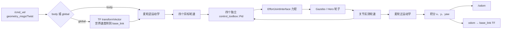
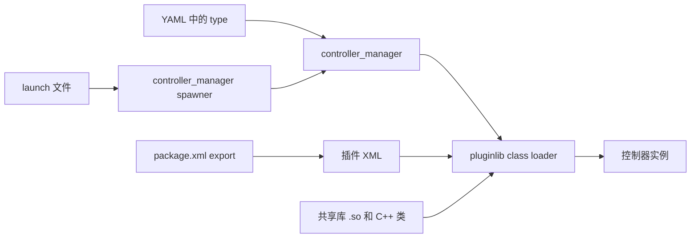

# 考核汇报视频提纲（约 12 分钟）

按团队统一 PPT 模板排版。方括号中的内容必须用自己在 Linux/CLion/Gazebo 上的真实记录替换；没有运行证据时不要写成已实现或已验证。

| 时间 | 页 | 内容与讲解重点 | 演示/材料 |
| --- | --- | --- | --- |
| 0:00–0:40 | 1. 目标与完成范围 | 用一句话说明任务：给 Hero 麦轮底盘做 `ros_control` 控制器，并按评分项验证。 | 姓名、年级、项目仓库名 |
| 0:40–1:40 | 2. 环境与参考工程 | 说明 ROS Noetic、Gazebo、CLion；展示 `rm_description_for_task` 和参考 `simple_chassis_controller`。 | [填入 Ubuntu/ROS 版本、master 分支证据和参考仿真画面] |
| 1:40–2:50 | 3. 控制器如何加载 | 讲清 `Controller<EffortJointInterface>`、pluginlib XML、package.xml 导出、YAML type、controller_manager spawner 的关系。 | 简单结构图；CLion 中的插件 XML 和 launch |
| 2:50–4:10 | 4. 麦轮逆运动学 | 定义 `base_link` 的 x/y/z；解释 `vx, vy, wz` 到四轮目标角速度的符号，特别是前进、左移和逆时针转动。 | 公式；[填入实测轮速符号或 rqt_plot 截图] |
| 4:10–5:50 | 5. 四轮独立 PID | 讲 `error = target - measured`，PID 输出力矩到 EffortJointInterface；介绍 YAML 参数、积分限幅和动态调参。 | [填入 rqt_reconfigure 调参记录和期望/实测轮速曲线] |
| 5:50–7:20 | 6. 正运动学与里程计 | 从四轮实测速度恢复车体 `vx, vy, wz`，积分得到 `odom` 中的位姿；说明中点朝向积分。 | [填入 `/odom` 输出和直行/侧移/旋转演示] |
| 7:20–8:25 | 7. TF 发布 | 说明 `/odom` 的 pose 和 `odom -> base_link` 必须一致，并展示 TF 树/`tf_echo`。 | [填入 `rosrun tf tf_echo odom base_link` 输出] |
| 8:25–9:45 | 8. 全局速度模式 | `Twist` 自身没有 frame_id，因此配置 `world_frame_id`；用 `transformVector` 将世界速度旋转到 `base_link`。 | [填入机器人先转向再沿世界坐标 x/y 移动的实测录屏] |
| 9:45–10:40 | 9. 特色功能 | 展示超时停车、轮速加速度限制和键盘遥控，说明配置位置。 | [填入实测运行画面] |
| 10:40–11:40 | 10. 调试与问题复盘 | 展示 CLion attach 到 `gzserver` 的断点；总结遇到的真实问题、排查方法和参数变化。 | [填入断点、变量和提交记录截图] |
| 11:40–12:20 | 11. 总结与引用 | 总结完成了什么、哪些参数经实测确认；列出参考仓库、control_toolbox/Pid 和麦轮公式资料。 | [填入最终评分清单与代码仓库链接] |

## 可转成 PPT 的两张结构图

### 命令、轮速闭环和里程计

讲解时沿着“命令前馈 → 轮速闭环 → 关节反馈 → 里程计输出”顺序走一遍。请在实际演示中同步展示目标/实测轮速曲线和 `/odom`，不要把结构图当作运行证据。

### pluginlib 加载链

讲解时说明每个文件负责一件事：C++ 导出类、XML 写类名和库名、package.xml 注册 XML、YAML 选择插件类型、spawner 请求 controller_manager 加载。

## 录制顺序

1. 先展示启动命令和 Gazebo 中的 Hero，确认正在运行自己提交的控制器。
2. 连续演示前进、左移、原地旋转，屏幕同步显示 `/cmd_vel`、轮速曲线和 `/odom`。
3. 在 `rqt_reconfigure` 调整一项 PID 参数，指出曲线和响应的实际变化。
4. 演示 `odom -> base_link`，切换 global 模式后验证世界坐标速度。
5. 演示超时停车、键盘控制和加速度限制。
6. 展示 CLion 对 `gzserver` 的断点调试和简洁的 Git 提交历史。

最终视频应落在 10–15 分钟，并且必须完整运行代码、展示实现功能。当前提纲不是运行结果证明；各处占位符待实际仿真后填写。
